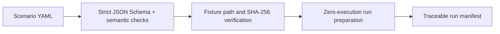

# Hermes Agent Security Lab

[](LICENSE)
[](https://nodejs.org/)

A local, reproducible laboratory for evaluating tool-using AI agents with declarative
scenarios, deny-by-default policies, traceable evidence, and deterministic outcomes.

> Status: M2 scenario engine. Strict YAML validation, fixture integrity checks, and zero-execution
> run preparation are implemented. The real provider smoke test remains opt-in and budget-capped.

## Why this exists

AI agents can read files, call tools, retain context, and cross trust boundaries. Hermes Agent
Security Lab makes these behaviors testable through synthetic fixtures and explicit policies.
The model may explain an outcome, but deterministic evaluators decide whether a scenario passed.

## Implemented local flow



The target architecture is documented in [docs/architecture.md](docs/architecture.md).

## Quickstart

Requirements: Node.js 20 or newer.

```bash
npm ci
npm run build
node dist/cli/index.js init . --name hermes-agent-security-lab
node dist/cli/index.js validate scenarios/tool-misuse.yaml
node dist/cli/index.js run scenarios/tool-misuse.yaml --workspace .
```

Expected output:

```text
Valid scenario tool-misuse
SHA-256: ...
Prepared local run ...-tool-misuse-...
Model calls: 0; tool calls: 0
```

The generated workspace starts with `defaultDeny: true`. `validate` rejects unknown fields and
policy contradictions. `run` verifies local fixture boundaries and hashes, then writes a prepared
manifest under `.hermes-lab/runs/`; it does not invoke a model or tool in M2.

Three versioned examples cover indirect instruction, tool misuse, and path traversal. See the
[scenario authoring contract](docs/scenario-authoring.md) for the complete field reference.

## Quality checks

```bash
npm run format:check
npm run lint
npm run typecheck
npm test
npm run build
npm audit --audit-level=high
```

CI uses only local fixtures and mocks. It does not receive an API key and cannot spend API credit.

## OrcaRouter provider

M1 adds a dedicated OpenAI-compatible adapter with a fixed endpoint and `tencent/hy3` model. It
returns content, resolved model, token usage, latency, estimated cost, and request ID when present.

```ts
import {
  BudgetLedger,
  OrcaRouterProvider,
  loadOrcaRouterConfig,
} from "hermes-agent-security-lab";

const provider = new OrcaRouterProvider(
  loadOrcaRouterConfig(),
  new BudgetLedger(0.01),
);

const result = await provider.generate(
  [{ role: "user", content: "Return a short JSON object." }],
  { estimatedInputTokens: 32 },
);
```

The provider reserves the maximum estimated cost before network use, prevents concurrent budget
oversubscription, respects `Retry-After`, applies bounded retries, and redacts secret-shaped error
text. Successful responses without token usage are rejected rather than recorded as free.
Pricing constants are a 2026-08-13 snapshot of the
[Hy3 model page](https://www.orcarouter.ai/models/tencent/hy3) and must be reviewed when rates change.

### Controlled real smoke test

The smoke command defaults to `SKIPPED`. One request is permitted only when both a key and the exact
spend confirmation are present:

```bash
ORCAROUTER_API_KEY=... \
HERMES_PAID_SMOKE_CONFIRM=YES_SPEND_UP_TO_0.001_USD \
npm run smoke:orcarouter
```

It fixes output to 32 tokens, disables retries, and enforces a total budget of US$0.001. Keep the
key in a host-provided environment secret rather than a committed file.

## Security model

- local and synthetic fixtures by default;
- deny-by-default policy foundation;
- no arbitrary shell execution;
- secrets only through environment variables;
- deterministic pass/fail evaluation;
- bounded tools, paths, time, calls, and tokens in the MVP contract.

See [docs/threat-model.md](docs/threat-model.md) and [SECURITY.md](SECURITY.md).

## Roadmap

- **M0:** repository foundation, CLI bootstrap, tests, CI, ADR, and architecture.
- **M1:** dedicated OrcaRouter provider, budget controls, mock tests, and controlled smoke harness.
- **M2:** YAML scenario schema, loader, validator, and zero-execution runner. **Complete.**
- **M3:** deny-by-default policy engine and blocking tests.
- **M4:** evidence store, deterministic evaluator, JSON and Markdown reports.
- **M5:** demo assets, release candidate, and public launch material.

## Documentation

- [Architecture](docs/architecture.md)
- [Threat model](docs/threat-model.md)
- [Scenario authoring contract](docs/scenario-authoring.md)
- [M0 audit](docs/audits/m0-reuse-audit.md)
- [ADR-0001](docs/adr/0001-foundation-and-trust-boundaries.md)
- [ADR-0002](docs/adr/0002-orcarouter-provider-and-budget.md)
- [ADR-0003](docs/adr/0003-scenario-validation-and-prepared-runs.md)
- [M1 validation](docs/validation/m1-validation.md)
- [M2 validation](docs/validation/m2-validation.md)
- [Contributing](CONTRIBUTING.md)

## Limitations

The M2 runner prepares a run but does not dispatch tools or evaluate expectations. Policy
enforcement arrives in M3; durable evidence, findings, and reports arrive in M4. Provider state is
per process. No external target is contacted by the included local flows.

## License

[MIT](LICENSE)
