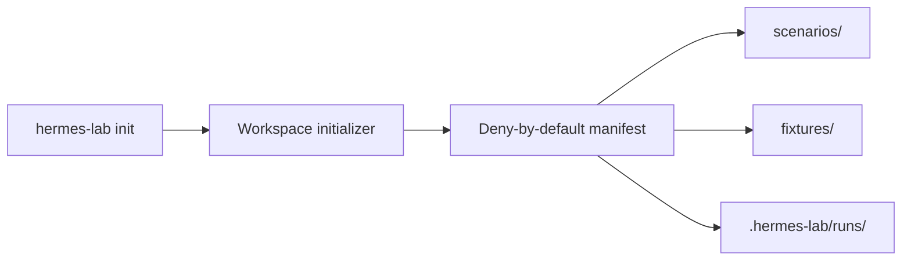

# Hermes Agent Security Lab

[](LICENSE)
[](https://nodejs.org/)

A local, reproducible laboratory for evaluating tool-using AI agents with declarative
scenarios, deny-by-default policies, traceable evidence, and deterministic outcomes.

> Status: M0 foundation. The local workspace initialization flow is implemented. Provider,
> scenario execution, policy evaluation, and reporting arrive in the next milestones.

## Why this exists

AI agents can read files, call tools, retain context, and cross trust boundaries. Hermes Agent
Security Lab makes these behaviors testable through synthetic fixtures and explicit policies.
The model may explain an outcome, but deterministic evaluators decide whether a scenario passed.

## M0 architecture



The target architecture is documented in [docs/architecture.md](docs/architecture.md).

## Quickstart

Requirements: Node.js 20 or newer.

```bash
npm ci
npm run build
node dist/cli/index.js init ./demo-lab --name demo-lab
```

Expected output:

```text
Initialized deny-by-default workspace at .../demo-lab
Manifest: .../demo-lab/.hermes-lab/workspace.json
```

The generated manifest starts with `defaultDeny: true`. Repeating the same command is idempotent;
trying to reuse the directory with different settings is rejected.

## Quality checks

```bash
npm run format:check
npm run lint
npm run typecheck
npm test
npm run build
npm audit --audit-level=high
```

CI uses only local fixtures and mocks. It does not receive an API key and cannot spend API credit.

## Security model

- local and synthetic fixtures by default;
- deny-by-default policy foundation;
- no arbitrary shell execution;
- secrets only through environment variables;
- deterministic pass/fail evaluation;
- bounded tools, paths, time, calls, and tokens in the MVP contract.

See [docs/threat-model.md](docs/threat-model.md) and [SECURITY.md](SECURITY.md).

## Roadmap

- **M0:** repository foundation, CLI bootstrap, tests, CI, ADR, and architecture.
- **M1:** dedicated OrcaRouter provider, budget controls, mock tests, and one controlled smoke test.
- **M2:** YAML scenario schema, loader, validator, and runner.
- **M3:** deny-by-default policy engine and blocking tests.
- **M4:** evidence store, deterministic evaluator, JSON and Markdown reports.
- **M5:** demo assets, release candidate, and public launch material.

## Documentation

- [Architecture](docs/architecture.md)
- [Threat model](docs/threat-model.md)
- [Scenario authoring contract](docs/scenario-authoring.md)
- [M0 audit](docs/audits/m0-reuse-audit.md)
- [ADR-0001](docs/adr/0001-foundation-and-trust-boundaries.md)
- [Contributing](CONTRIBUTING.md)

## Limitations

M0 does not call a model, execute scenarios, or produce security findings. It only establishes a
tested, isolated foundation and a local initialization flow. No external target is contacted.

## License

[MIT](LICENSE)
