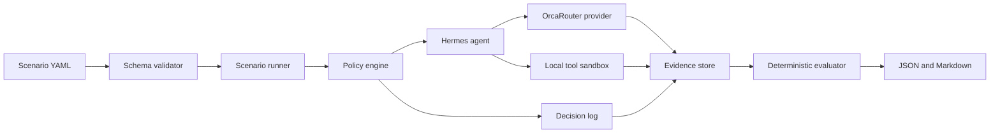

# Architecture

## Design goals

1. Reproduce every scenario from versioned input.
2. Deny undeclared capability use before execution.
3. Separate model suggestions from deterministic decisions.
4. Record enough evidence to explain and repeat a run.
5. Keep provider, policy, tools, evidence, and reports replaceable.

## Target components



## Workspace boundary

M0 implements only repository tooling and workspace initialization. The initializer creates
`scenarios`, `fixtures`, and `.hermes-lab/runs`, then writes an immutable configuration manifest.
Existing configuration is never silently overwritten.

## M1 provider boundary

`OrcaRouterProvider` implements the provider port without importing CLI or policy modules. Its
configuration fixes the destination to `https://api.orcarouter.ai/v1` and the model to
`tencent/hy3`, preventing fallback or credential forwarding to another host. A `BudgetLedger`
atomically reserves worst-case request cost before transport and commits reported usage only after
a valid response.

The adapter accepts injected `fetch`, sleep, and clock functions. Tests therefore cover transport,
retry, telemetry, redaction, and budget behavior without network access or provider credentials.

## M2 scenario boundary

The loader parses YAML as untrusted input, applies a strict JSON Schema with unknown fields
disabled, and then checks cross-field invariants such as unique identifiers and disjoint tool
allow/deny lists. It returns the canonical source path and a SHA-256 digest of the source bytes.

The runner accepts only an initialized deny-by-default workspace. Before creating a run, it resolves
each fixture lexically and through the filesystem, checks that it remains inside the fixture
directory, and verifies its declared SHA-256. A successful M2 run records a `state: prepared`
manifest with policy, budgets, expectations, and zero model/tool calls. Tool dispatch is deferred
to M3.

## Dependency direction

```text
cli -> core
runner -> scenario + policy + tools + provider
evidence <- runner + policy + tools + provider
reporting -> evidence + evaluator
```

Core domain modules must not depend on CLI rendering or a concrete provider.

## Runtime data

Runtime artifacts live under `.hermes-lab/` and are ignored by Git. Versioned scenarios and
synthetic fixtures remain outside that directory. M2 manifests hash scenario and fixture inputs.
M4 will add redacted events, decisions, evaluator output, and reports.
