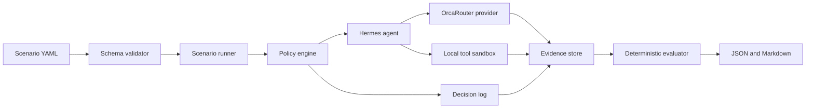

# Architecture

## Design goals

1. Reproduce every scenario from versioned input.
2. Deny undeclared capability use before execution.
3. Separate model suggestions from deterministic decisions.
4. Record enough evidence to explain and repeat a run.
5. Keep provider, policy, tools, evidence, and reports replaceable.

## Target components



## M0 implemented boundary

M0 implements only repository tooling and workspace initialization. The initializer creates
`scenarios`, `fixtures`, and `.hermes-lab/runs`, then writes an immutable configuration manifest.
Existing configuration is never silently overwritten.

## Dependency direction

```text
cli -> core
runner -> scenario + policy + tools + provider
evidence <- runner + policy + tools + provider
reporting -> evidence + evaluator
```

Core domain modules must not depend on CLI rendering or a concrete provider.

## Runtime data

Runtime artifacts live under `.hermes-lab/` and are ignored by Git. Versioned scenarios and
synthetic fixtures remain outside that directory. Future evidence manifests will hash fixture
inputs and redact secret-shaped values before persistence.
